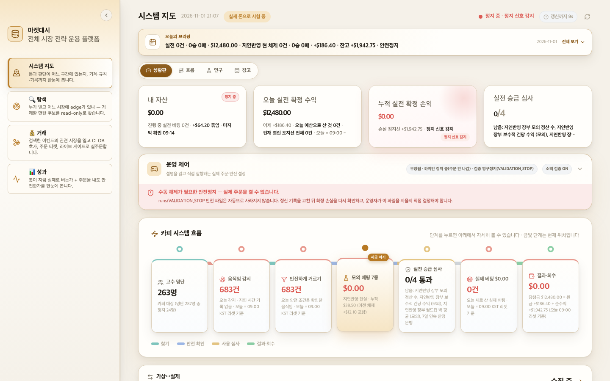
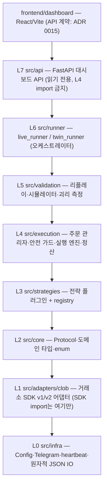
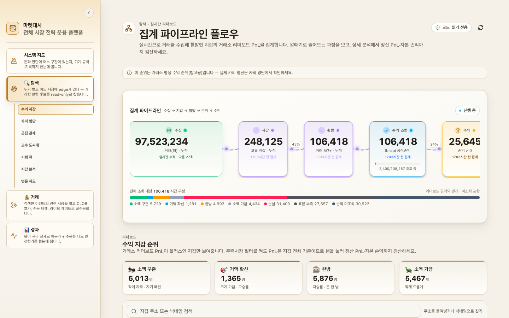
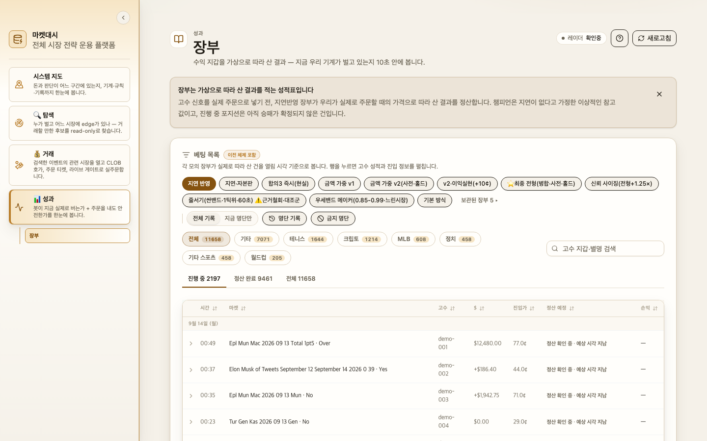

# marketdash — 5분 바이너리 시장 전략 운용 플랫폼

> 온라인 예측시장의 **5분 단위 Up/Down 바이너리 시장**을 대상으로, 실시간 데이터 수집 → 전략 신호 → 모의/실전 주문 → 정산·회수까지를 하나의 파이프라인으로 돌리고, React 대시보드로 관제하는 프로그램입니다.
> 설계(계층 아키텍처·ADR·수용 테스트)와 구현 전 과정을 **AI 코딩 에이전트(Claude Code)** 와 함께 진행했습니다.
>
> 이 저장소는 **구조 스냅샷**입니다. 모듈·클래스·함수 시그니처와 한 줄 설명, 설계 문서, 화면 캡처만 담았고 구현 본문·설정·데이터는 비웠습니다. 실행되지 않습니다.



*대시보드 첫 화면 "시스템 지도" — 자금·판단이 어느 단계에 있는지, 기계·규칙·기록을 한 화면에 모았습니다. (화면의 금액·지갑은 데모 값입니다.)*

---

## 1. 무엇을 하는 프로그램인가

| 단계 | 역할 | 코드 |
| --- | --- | --- |
| 수집 | 현물 거래소 체결·예측시장 호가/체결·오라클 정산가를 1초 주기로 받아 `latest.json` 스냅샷 한 장으로 합침 | `scripts/run_collector.py`, `src/infra/` |
| 전략 | 스냅샷을 읽고 `Signal`(BUY/FLAT)을 내는 플러그인. 파일 하나 = 전략 하나 | `src/strategies/` |
| 실행 | 신호를 paper(모의) / live(실전) / twin(둘 동시) 엔진으로 라우팅, 안전 가드·킬 스위치·일일 손실 한도 | `src/execution/`, `src/runner/` |
| 정산 | 창 종료 후 오라클 정산가로 승패 확정, 자동 환매 | `src/execution/settlement_manager.py` |
| 거래소 어댑터 | 거래소 SDK v1/v2를 하나의 `CLOBClient` Protocol 뒤에 숨김 | `src/adapters/clob/` |
| 관제 | FastAPI 읽기 전용 API + React/Vite 대시보드 (시스템 지도·탐색·거래·성과) | `src/api/`, `frontend/dashboard/` |
| 검증 | 리플레이·시뮬레이터·paper↔live 괴리 측정 | `src/validation/` |

## 2. 설계는 어떻게 했나

### 2.1 계층 아키텍처 (L0 → L7, 위 계층은 아래 계층만 import)



계층 규칙은 문서가 아니라 **테스트가 강제**합니다 — `tests/test_architecture/test_layer_boundaries.py` 가 import 그래프를 AST로 읽어 위반을 실패로 만듭니다.

### 2.2 전략 = 플러그인 (Protocol + 데코레이터)

```python
# src/core/protocol.py
class Strategy(Protocol):
    name: str
    def init(self, params: dict) -> None: ...
    def warmup_ticks(self) -> int: ...
    def on_tick(self, snapshot, history, portfolio) -> Signal | None: ...

# src/strategies/p1_confident_direction.py
@register_strategy(name="p1_confident_direction", ...)
class P1ConfidentDirectionStrategy: ...
```

전략 파일 하나를 추가하면 레지스트리·러너·대시보드가 그대로 인식합니다. (`tests/acceptance/test_add_strategy_one_file.py` 가 이 약속을 검사합니다.)

### 2.3 결정은 ADR로 남김 (`docs/adr/`, 15건)

| ADR | 결정 |
| --- | --- |
| 0001 | paper / live / twin 이 같은 ExecutionEngine 인터페이스를 쓴다 |
| 0003 | 거래 로그는 **쓰는 시점에** 검증하고 오염 행은 격리한다 |
| 0008 | 테스트 품질 게이트 (가짜 테스트 금지, 변이 시험) |
| 0013 | 모든 전략을 같은 시뮬레이터로 돌리는 universal sim runner |
| 0014 | 거래소 SDK v2 이전 + 3전략 로스터 + 수용 테스트를 성공 기준으로 |
| 0015 | React 대시보드와 API 사이의 계약 (`/dashboard/manifest`) |

### 2.4 수용 테스트 = 실행 가능한 설계 명세 (`tests/acceptance/`)

| 테스트 | 증명하는 것 |
| --- | --- |
| `test_add_strategy_one_file` | 데코레이터 붙은 파일 하나 → 레지스트리가 인식, 로더 수정 불필요 |
| `test_remove_strategy_runner_starts` | 전략 하나를 빼도 나머지가 정상 기동 |
| `test_three_strategy_roster` | 활성 전략 3개가 모두 `on_tick` 까지 도달 |
| `test_dashboard_endpoint` | `/runtime/status` 가 JSON을 주고, API 계층이 실행 계층을 import 하지 않음 |
| `test_clob_v2_canary` | SDK v2 5개 기준 (잔고 0 지갑에서도 안전하게 통과) |

### 2.5 AI와 함께 만든 방식

1. **설계 지도를 먼저 쓴다** — `CLAUDE.md` 가 AI 에이전트에게 주는 프로젝트 지도입니다 (계층, "어디서 찾나" 표, 금지 패턴, 운영 규칙).
2. **결정은 ADR, 약속은 테스트로** — 새 기능은 ADR 한 장과 수용 테스트부터 쓰고, 그 테스트를 통과시키는 구현을 AI가 작성합니다.
3. **경계는 테스트가 지킨다** — 계층 위반·SDK 직접 import·전략 문자열 레지스트리 같은 설계 이탈은 `tests/test_architecture/` 가 즉시 실패시킵니다.
4. **한 번에 한 라운드** — 계획을 여러 번 고치지 않고, 후속 질문은 ADR/테스트로 흘려보냅니다.

## 3. 화면

**탐색** — 실시간 수집 → 지갑 → 활발 → 손익 → 수익 지갑으로 좁혀 가는 집계 파이프라인과 리더보드를 읽기 전용으로 봅니다.



**성과** — 모의 장부. 신호를 실제 주문가로 따라 샀을 때의 결과를 열림 시각 기준으로 정산합니다.



*모든 화면의 금액·지갑은 데모 값으로 치환했습니다.*

## 4. 저장소 구조

```
src/
  core/          Protocol · 도메인 타입 · enum            (전문 수록)
  adapters/clob/ 거래소 SDK v1/v2 어댑터 + factory        (시그니처)
  strategies/    전략 플러그인 + registry                 (registry 전문, 전략은 시그니처)
  execution/     주문 관리자 · 안전 가드 · 엔진 · 정산     (시그니처)
  runner/        live_runner · twin_runner                (시그니처)
  validation/    리플레이 · 시뮬레이터 · 괴리 측정         (시그니처)
  api/           FastAPI 대시보드 API                     (시그니처)
  infra/         Config · Telegram · heartbeat            (시그니처)
frontend/dashboard/   React 19 + Vite 대시보드 (진입점·네비게이션·API 타입만)
tests/acceptance/     수용 테스트 (시그니처 + 한 줄 설명)
tests/test_architecture/  계층 경계 테스트 (시그니처 + 한 줄 설명)
docs/adr/             아키텍처 결정 기록 15건 (전문)
docs/images/          화면 캡처
```

## 5. 공개 범위

운영 저장소의 **구조만 남긴 공개용 스냅샷**입니다. 구현 본문, 전략 파라미터, 설정, 수집 데이터, 거래 기록, 연구 산출물은 모두 제외했고, 거래소·데이터 공급자 이름은 일반 명사로 바꿨습니다. 수익을 보장하는 소프트웨어가 아닙니다.
